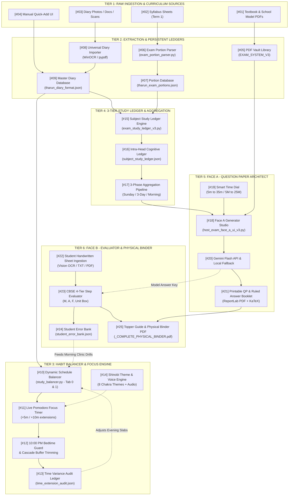
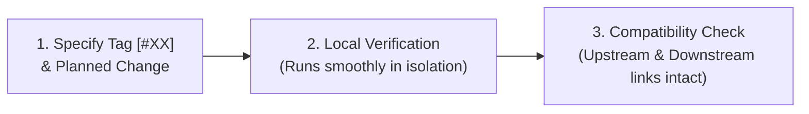

# ScholasticPulse Master System Flowchart & Tagged Hierarchical Component Directory

> **System**: ScholasticPulse (Tharun Class 8 CBSE Study Balancer & AI Examination Suite)  
> **Workspace**: `D:\THARUN PROJECT`  
> **Active Executable**: `ScholasticPulse_V3.exe` (`VERSION_3_WORKPLACE`)  
> **Architecture Standard**: Hierarchical Tagging Index (01 – 24)

---

## 1. Complete System Flowchart with Unique Order-Wise Tags `[#01]` – `[#24]`

---

## 2. Tagged Hierarchical Component Directory (In Order)

### TIER 1: Raw Ingestion & Curriculum Sources

#### `[#01]` Textbook & School Model Exam PDFs
* **Simple English**: The original reference documents, including NCERT textbook chapters and Senthil Public School model test papers.
* **Input**: Uploaded physical textbook scans or official school PDFs.
* **Output / Destination**: Stored inside [`EXAM_SYSTEM_V3/02_UPLOADED_TEXTBOOKS_PDF`](file:///d:/THARUN%20PROJECT/EXAM_SYSTEM_V3/02_UPLOADED_TEXTBOOKS_PDF) and [`02_SCHOOL_MODEL_PAPERS_PDF`](file:///d:/THARUN%20PROJECT/EXAM_SYSTEM_V3/02_SCHOOL_MODEL_PAPERS_PDF).
* **Direct Links**: Connected to `[#05]` (PDF Vault Library) and `[#18]` (Face A Question Paper Architect).

#### `[#02]` Syllabus & Portion Sheets (Term 1)
* **Simple English**: The official school document listing what chapters and marks are scheduled for Tharun's upcoming examinations.
* **Input**: Teacher syllabus handouts, circular PDFs, or term portion lists.
* **Output / Destination**: Delivered directly to the portion parsing script.
* **Direct Links**: Feeds into `[#06]` (Exam Portion Parser).

#### `[#03]` School Diary Photos, Docs & Handbook Scans
* **Simple English**: Photos or documents of Tharun's physical student handbook containing daily homework notes written in class.
* **Input**: Camera photos (`.jpg`, `.png`), Word documents (`.docx`), or scanned PDFs.
* **Output / Destination**: Transferred into the universal diary ingestion tool.
* **Direct Links**: Feeds into `[#08]` (Universal Diary Importer).

#### `[#04]` Manual Quick-Add Diary UI
* **Simple English**: The interactive screen in the desktop app where parents or Tharun can type homework items directly when no photo is used.
* **Input**: User text inputs (Subject, task name, estimated study minutes).
* **Output / Destination**: Direct JSON entries written to the diary database.
* **Direct Links**: Directly commits into `[#09]` (Master Diary Database).

---

### TIER 2: Extraction & Persistent Databases

#### `[#05]` PDF Vault Library (`EXAM_SYSTEM_V3`)
* **Simple English**: The local repository that extracts raw text and question banks from textbooks and school papers for offline use.
* **Input**: Files from `[#01]`.
* **Output / Destination**: Text chunks and indexed questions in `textbook_library_catalog.json`.
* **Direct Links**: Feeds directly into `[#18]` (Face A Question Paper Architect).

#### `[#06]` Exam Portion Parser (`exam_portion_parser.py`)
* **Simple English**: A Python script that reads the syllabus sheet and splits it into individual subjects, chapter names, and mark weightages.
* **Input**: Syllabus files from `[#02]`.
* **Output / Destination**: Formatted JSON data containing chapter structures.
* **Direct Links**: Creates and updates `[#07]` (Portion Database).

#### `[#07]` Portion Database (`tharun_exam_portions.json`)
* **Simple English**: The central file storing Tharun's exact syllabus topics, chapter priorities, and mark distributions.
* **Input**: Generated by `[#06]`.
* **Output / Destination**: Syllabus maps delivered to the study ledger and question creator.
* **Direct Links**: Connects to `[#15]` (Subject Study Ledger Engine).

#### `[#08]` Universal Diary Importer (`diary_importer.py`)
* **Simple English**: An automated tool that uses Windows Native Offline OCR (`winocr`) and text regex to extract homework from diary images or files.
* **Input**: Raw files from `[#03]`.
* **Output / Destination**: Clean structured homework items with subject tags and time estimates.
* **Direct Links**: Commits clean records to `[#09]` (Master Diary Database).

#### `[#09]` Master Diary Database (`tharun_diary_format.json`)
* **Simple English**: The single master database containing all past and present school diary homework records.
* **Input**: Created by `[#04]` and `[#08]`.
* **Output / Destination**: Structured daily tasks for the schedule balancer and study ledger.
* **Direct Links**: Feeds into `[#10]` (Dynamic Schedule Balancer) and `[#15]` (Subject Study Ledger Engine).

---

### TIER 3: Habit Balancer & Focus Engine

#### `[#10]` Dynamic Schedule Balancer (`study_balancer.py` - Tab 0 & 1)
* **Simple English**: The core engine that arranges Tharun's evening and morning study slots based on diary tasks, capping long sessions to stop mental fatigue.
* **Input**: Data from `[#09]` (Master Diary Database) and feedback from `[#24]` (Student Error Bank).
* **Output / Destination**: Active visual timetable slabs on the desktop screen.
* **Direct Links**: Feeds into `[#11]` (Focus Timer); influenced by `[#12]` (Bedtime Guard).

#### `[#11]` Live Pomodoro Focus Timer
* **Simple English**: The countdown clock Tharun looks at while studying, featuring `+5m` and `+10m` extension buttons if he needs more time.
* **Input**: Selected study slot from `[#10]`.
* **Output / Destination**: Real-time study completion marks and elapsed time metrics.
* **Direct Links**: Sends overrun alerts to `[#12]` (Bedtime Guard); updates `study_routine_data.json`.

#### `[#12]` 10:00 PM Bedtime Guard & Cascade Trimming
* **Simple English**: An unskippable safety rule that automatically shortens breaks and reading slots when sessions run late, guaranteeing Tharun sleeps by 10:00 PM.
* **Input**: Time extension signals from `[#11]`.
* **Output / Destination**: Re-balanced schedule with deferred morning slots; audit records.
* **Direct Links**: Writes every overrun event into `[#13]` (Audit Ledger).

#### `[#13]` Time Variance Audit Ledger (`time_extension_audit.json`)
* **Simple English**: A permanent record listing every study delay, how many minutes were added, and why the delay happened.
* **Input**: Triggered by `[#12]`.
* **Output / Destination**: Historical audit logs used to refine daily study plans.
* **Direct Links**: Loops back into `[#10]` to calibrate future slot durations.

#### `[#14]` Shinobi Theme & Voice Audio Engine
* **Simple English**: The motivational system that rotates 8 anime themes and plays audio cues to keep Tharun focused and engaged.
* **Input**: App launch event or user theme dropdown selection.
* **Output / Destination**: Background colors, scroll-style widgets, and audio feedback.
* **Direct Links**: Visual overlay and audio controller for `[#11]` (Focus Timer).

---

### TIER 4: 3-Tier Study Ledger & Aggregation (Tab 2)

#### `[#15]` Subject Study Ledger Engine (`exam_study_ledger_v3.py`)
* **Simple English**: The bridge program that takes completed homework and syllabus units and catalogs them for future exams.
* **Input**: Data from `[#09]` (Diary Database) and `[#07]` (Portion Database).
* **Output / Destination**: Categorized study units indexed by week and month.
* **Direct Links**: Sends records to `[#16]` (Intra-Head Cognitive Ledger).

#### `[#16]` Intra-Head Cognitive Ledger (`subject_study_ledger.json`)
* **Simple English**: A structured database sorting all studied topics into 3 cognitive heads: Head 1 (Theories), Head 2 (Math/Problems), and Head 3 (Diagrams/Spelling).
* **Input**: Structured by `[#15]`.
* **Output / Destination**: 68+ categorized study entries accessible by week filters.
* **Direct Links**: Feeds into `[#17]` (3-Phase Aggregation Pipeline).

#### `[#17]` 3-Phase Aggregation Pipeline (`exam_phase_assembler_v3.py`)
* **Simple English**: The filter engine that selects exactly what topics will appear in tests (Phase 1 Sunday/Month-End, Phase 2 3-Day Checkpoint, or Phase 3 Exam Eve Sprint).
* **Input**: Filtered entries from `[#16]`.
* **Output / Destination**: Concrete test blueprints with assigned mark totals and time limits.
* **Direct Links**: Feeds into `[#18]` (Face A Question Paper Architect).

---

### TIER 5: Face A - Question Paper Architect

#### `[#18]` Face A Generator Studio (`host_exam_face_a_ui_v3.py`)
* **Simple English**: The screen where parents generate a customized exam paper by selecting time, questions, and curriculum references.
* **Input**: Blueprint from `[#17]`, slider settings from `[#19]`, and textbook text from `[#05]`.
* **Output / Destination**: Instruction prompt package sent to the AI generator.
* **Direct Links**: Connects to `[#20]` (Gemini API & Local Fallback).

#### `[#19]` Smart Time Dial
* **Simple English**: A simple slider on the UI to pick test size: 5m Rapid (5M), 10m Express (10M), 20m Standard (15M), or 35m Full (25M).
* **Input**: User click or slider drag.
* **Output / Destination**: Marks and duration parameters sent to `[#18]`.
* **Direct Links**: Controls settings in `[#18]`.

#### `[#20]` Gemini Flash API & Zero-Lag Local Fallback
* **Simple English**: The intelligence engine that crafts authentic CBSE-standard questions. If the internet drops, an offline local rule engine creates the paper instantly.
* **Input**: Prompt payload from `[#18]`.
* **Output / Destination**: Complete question paper JSON with questions, mark allocations, and model answer keys.
* **Direct Links**: Sends output to `[#21]` (Print Studio) and `[#23]` (Evaluator Key).

#### `[#21]` Printable Question Paper & Ruled Answer Booklet (`exam_print_studio_v3.py`)
* **Simple English**: The module that converts generated questions into beautiful, printable PDFs along with empty lined answer sheets for Tharun to write on.
* **Input**: Question Paper JSON from `[#20]`.
* **Output / Destination**: `EXAM-*.pdf` question papers and blank answer booklet PDFs.
* **Direct Links**: Stored in `03_GENERATED_QUESTION_PAPERS`; feeds into `[#25]` (Physical Binder).

---

### TIER 6: Face B - Evaluator, Error Bank & Physical Binder

#### `[#22]` Student Handwritten Sheet Ingestion (`host_exam_face_b_ui_v3.py`)
* **Simple English**: The portal where Tharun's completed handwritten test sheet is scanned, photographed, or loaded for grading.
* **Input**: Scanned PDF or camera photo of Tharun's handwritten steps.
* **Output / Destination**: Clean image or text stream for transcription.
* **Direct Links**: Feeds into `[#23]` (CBSE 4-Tier Evaluator).

#### `[#23]` CBSE 4-Tier Step Evaluator (`exam_vision_ocr_engine_v3.py` & Evaluator)
* **Simple English**: The grading engine that uses Gemini Multimodal Vision to inspect Tharun's handwriting and grade him step-by-step on Method, Accuracy, Formulation, and Final Unit Box.
* **Input**: Handwritten scan from `[#22]` and official answer key from `[#20]`.
* **Output / Destination**: Graded evaluation record with red-ink marks and specific correction comments.
* **Direct Links**: Updates `[#24]` (Student Error Bank); delivers graded copy to `[#25]`.

#### `[#24]` Student Error Bank (`student_error_bank.json`)
* **Simple English**: The long-term notebook storing Tharun's repeated mistakes (arithmetic calculation slips, Tamil ழ/ள/ல confusions, missing units).
* **Input**: Mistake logs generated by `[#23]`.
* **Output / Destination**: List of weak areas requiring remediation.
* **Direct Links**: Feeds directly into `[#10]` to build targeted Morning Clinic drills.

#### `[#25]` Topper Model Guide & Complete Physical Binder PDF (`host_exam_topper_ui_v3.py`)
* **Simple English**: The final PDF assembler that combines the original question paper, Tharun's graded red-ink sheet, and the 100/100 Topper Model Answer Guide into a single printable document for filing in his physical ring binder.
* **Input**: Question Paper PDF from `[#21]`, Graded Sheet from `[#23]`, and Topper Guide from `[#23]`.
* **Output / Destination**: `_COMPLETE_PHYSICAL_BINDER.pdf` saved in `EXAM_SYSTEM_V3`.
* **Direct Links**: Final physical product for student review and parent inspection.

---

## 3. Protocol for Future Updates, Bug Fixes & New Feature Integrations

When requesting changes, bug fixes, or new features, use the following 3-step protocol:

1. **Specify the Tag Number**: State the box number (e.g., `[#08]` for diary import, `[#12]` for bedtime curfew, or `[#23]` for evaluation grading).
2. **Compatibility Audit**: Check upstream providers and downstream consumers to ensure data structures (JSON formats, schemas, file paths) match.
3. **Execution & Fallback Verification**: Confirm the component executes cleanly and preserves offline fallbacks so the app never crashes if an asset or network connection is missing.
