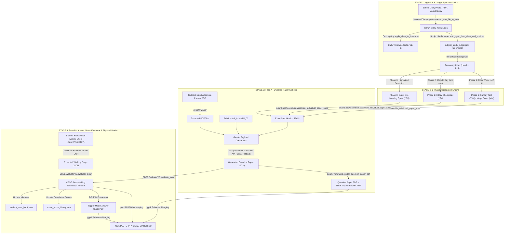

# SCHOLASTICPULSE V3: END-TO-END DATA LIFECYCLE & PROCESS FLOW AUDIT

> **Document Version**: 3.0.0-DATAFLOW  
> **Target Audience**: Systems Architects, AI Workflow Engineers, Pedagogical Data Auditors  
> **Focus**: Deep-dive tracing of a single data atom (e.g., a logged homework task) from user ingestion through the 3-phase aggregation pipeline, Gemini AI assessment, and output into the final physical binder PDF.  
> **Repository Base**: `D:\THARUN PROJECT\VERSION_3_WORKPLACE\`  
> **Generated At**: 2026-10-19T01:11:00+05:30  

---

## 1. END-TO-END DATA LIFECYCLE FLOWCHART



---

## 2. DATA INGESTION & STATE SYNCHRONIZATION

### 2.1 Source to Ledger: Ingestion Pathways
Data enters ScholasticPulse through two primary portals:
1. **Camera Photo / School Handbook PDF Upload** (`diary_importer.py`):
   - Invoked via `DesktopApp.upload_diary_photo()` or `upload_diary_pdf()`.
   - `UniversalDiaryImporter.convert_any_file_to_json(filepath, target_json)` invokes OCR / text extraction.
   - Handles multi-day page splits (e.g. Oct 14 top half vs Oct 15 bottom half) by detecting date headers (`Date: 14/10/26`) and bounding boxes.
   - Appends structured entries into `tharun_diary_format.json`.
2. **Interactive Quick-Add Slab** (`study_balancer.py`):
   - `DesktopApp.add_diary_item()` takes UI inputs (Subject dropdown, Task description entry, Estimated minutes, Task type).
   - Commits directly into `self.diary_data["diary_entries"]` and writes to disk via `self.save_diary_data()`.

### 2.2 Ledger Auto-Sync Pathway (`exam_study_ledger_v3.py`)
From `tharun_diary_format.json`, data automatically flows into `subject_study_ledger.json` via:
`SubjectStudyLedger.auto_sync_from_diary_and_portions()`

```python
@classmethod
def auto_sync_from_diary_and_portions(cls) -> Dict[str, Any]:
    ledger = cls.load_ledger()
    existing_keys = {
        f"{e.get('date')}_{e.get('subject')}_{e.get('task_description')[:30]}"
        for e in ledger.get("entries", [])
    }
    
    # Ingest from tharun_diary_format.json
    if os.path.exists(DIARY_FILE):
        with open(DIARY_FILE, "r", encoding="utf-8") as f:
            d_data = json.load(f)
        for day in d_data.get("diary_entries", []):
            d_date = day.get("date", "")
            d_items = day.get("items") or day.get("homework_tasks") or []
            w_num = cls._determine_week_number(d_date)
            for item in d_items:
                subj = item.get("subject", "General")
                task = item.get("task", "")
                k = f"{d_date}_{subj}_{task[:30]}"
                if k not in existing_keys:
                    intra_head = cls.categorize_into_intra_heads(subj, task, task)
                    ledger["entries"].append({
                        "date": d_date,
                        "month": "October",
                        "week_number": w_num,
                        "subject": subj,
                        "chapter_topic": task,
                        "intra_head": intra_head,
                        "task_description": task,
                        "study_status": "studied",
                        "source": "school_diary"
                    })
                    existing_keys.add(k)
    cls.save_ledger(ledger)
    return ledger
```

### 2.3 The 3-Tier Intra-Head Taxonomy Mapping
Every logged study slab is classified into an exact cognitive intra-head:
- **Head 1: Core Concepts & Principles**:
  - *Trigger Keywords*: `concept`, `rule`, `definition`, `law`, `reading`, `theory`, `learn`, `memorize`.
- **Head 2: Problem Solving & Applications**:
  - *Trigger Keywords*: `exercise`, `solve`, `questions`, `ex:`, `sums`, `ch-`, `written`, `practice`.
- **Head 3: Visual, Diagrammatic & Orthography**:
  - *Trigger Keywords*: `diagram`, `drawing`, `activity`, `map`, `handwriting`, `spelling`, `chart`.

### 2.4 Complete JSON Schema of a Study Slab in Ledger
```json
{
  "date": "2026-10-17",
  "month": "October",
  "week_number": 3,
  "subject": "Mathematics",
  "chapter_topic": "Mensuration (Cylinder & Trapezium)",
  "intra_head": "Head 2: Problem Solving & Applications",
  "task_description": "Area of trapezium and surface area of cylinders (Ex: 9.1 & 9.2)",
  "study_status": "studied",
  "source": "weekly_routine_logger"
}
```

---

## 3. THE 3-PHASE AGGREGATION PIPELINE

The `ExamPhaseAssembler` in `exam_engine_v3.py` (interfacing with `exam_phase_assembler_v3.py`) aggregates ledger data according to three distinct pedagogical triggers:

### 3.1 Phase 1 Data Flow: Weekly Sunday Tests & Month-End Mega Exam
* **Method**: `ExamPhaseAssembler.assemble_phase1_weekly_sunday_test(week_number, month)`
* **Query Logic**:
  ```python
  # Filters entries where week_number == target_week and source in ('school_diary', 'weekly_routine_logger')
  target_entries = [e for e in ledger["entries"] if e.get("week_number") == week_number]
  ```
* **Aggregation**:
  - Aggregates the 6 preceding days of homework (Monday through Saturday).
  - Groups entries by unique subjects to prevent mingling.
  - Dynamically computes required marks (35 Marks) and time allowed (60 Mins).
* **Month-End Mega Exam** (`assemble_phase1_monthend_mega_exam`):
  - Aggregates all 4 weeks of the month (Weeks 1–4, 68 total entries across Oct 01–24).
  - Configures an 80-Mark, 180-Minute comprehensive CBSE paper partitioned into 4 distinct sections:
    - *Section A*: Math Core (20M)
    - *Section B*: Science (Physics & Chemistry 10M, Biology 10M)
    - *Section C*: Social Science (History, Geo, Civics 20M)
    - *Section D*: Languages (Tamil & Hindi 20M)

### 3.2 Phase 2 Data Flow: Pre-Exam 3-Day Checkpoint
* **Method**: `ExamPhaseAssembler.assemble_phase2_3day_checkpoint(block_num)`
* **Query Logic**:
  - Calculates the 3-day block window using modulo arithmetic:
    $$\text{Start Day} = (\text{block\_num} - 1) \times 3 + 1$$
    $$\text{End Day} = \text{block\_num} \times 3$$
  - Filters the 21-Day Pre-Exam Schedule (`PRE_EXAM_21_DAYS` in `study_balancer.py`) for days belonging to that cluster.
  - Generates a targeted 25-Mark, 60-Minute checkpoint paper on those exact cumulative chapters.

### 3.3 Phase 3 Data Flow: Exam Eve Morning Retention Sprint
* **Method**: `ExamPhaseAssembler.assemble_phase3_morning_sprint(subject)`
* **Query Logic**:
  - Invoked on the morning of a school examination between 06:40 AM and 07:15 AM.
  - Pulls high-yield foundational elements for the upcoming exam subject from `tharun_exam_portions.json`:
    - Formulas & Theorems (Head 1)
    - Core Calculations (Head 2)
    - Labeled Ray Optics / Cell Diagrams (Head 3)
  - Output: 25 Marks, 35–45 Mins sprint paper designed to activate memory recall right before school departure.

---

## 4. FACE A: QUESTION PAPER ARCHITECT (API PAYLOAD PIPELINE)

When the user triggers question paper generation in Subview 4 (`host_exam_face_a_ui_v3.py`), data moves through the `GeminiExamClient` pipeline.

### 4.1 Input Payload Construction (`exam_question_architect_v3.py`)
1. **Aggregated Syllabus Topics**: Assembled by `ExamSpecAssembler`.
2. **Textbook & Sample Paper Extraction**:
   - `exam_engine_v3.py` invokes `extract_pdf_text_pypdf(pdf_path)`.
   - If the PDF contains non-searchable scanned images (MRC compression), the engine gracefully falls back to Windows native OCR (`winocr`).
   - Slices up to 4,000 characters of grounded reference material and 3,000 characters of school teacher phrasing style.
3. **Agent Skills & Pedagogical Rubrics**:
   - `skill_01_cbse_exam_planner_question_framing.md`: Strict section headers, mark distribution (MCQ 1M, VSA 2M, SA 3M, LA 5M), internal choices.
   - `skill_02_neat_question_paper_alignment_and_typesetting.md`: Visual hierarchy, KaTeX formula formatting, Indic typography rules.

### 4.2 Exact Google Gemini API System Prompt Structure
```text
You are the Chief Examination Controller and CBSE Question Architect for Class 8 at Senthil Public School.
Create an official CBSE question paper based strictly on the syllabus topics below.

EXAMINATION SPECIFICATIONS:
- Subject: Mathematics
- Class Standard: Class 8 CBSE
- Time Allowed: 20 minutes
- Maximum Marks: 15 Marks
- Target Exam: Daily Retention Sprint

SECTIONS & QUESTION TYPE DISTRIBUTION:
Section 1 ('SECTION A: CONCEPT FOUNDATION'): Allocate ~5 Marks. Types: MCQ, Very Short Answer
Section 2 ('SECTION B: STEP CALCULATIONS'): Allocate ~10 Marks. Types: Short Answer, Working Steps

SYLLABUS TOPICS (FROM THARUN'S STUDY LEDGER):
1. [Algebra] Mensuration: Area of trapezium and surface area of cylinders (Ex: 9.1 & 9.2)

GROUNDED REFERENCE MATERIAL (MATH_CH_09_ALGEBRAIC_EXPRESSIONS_EX_91_CONCEPT_SPRINT.pdf):
CRITICAL: The reference material below is an official TEXTBOOK EXERCISE / TOPIC PHOTOCOPY.
Directly model questions, algebraic equations, problem structures, or definitions on the content below!
"""[EXTRACTED TEXTBOOK EXCERPT]"""

SCHOOL SAMPLE QUESTION REFERENCE (MATH_SAMPLE_Q_TERM1_SENTHIL_SPS_TERM1_MODEL_2025.pdf):
CRITICAL: The reference below is an official sample question paper from Tharun's school.
Analyze the teacher's question framing, difficulty standard, and phrasing patterns below, and emulate this exact style:
"""[EXTRACTED SPS MODEL PAPER EXCERPT]"""

STRICT OUTPUT FORMAT RULES:
Return a PURE, VALID JSON object matching the CBSE Question Paper Schema.
Do not output markdown code blocks (```json). Ensure mathematical formulas use clean LaTeX syntax ($a^2 - b^2$).
```

---

## 5. FACE B & PHYSICAL BINDER COMPILATION

Once the student completes the paper on paper, data moves through Subview 5 (`host_exam_face_b_ui_v3.py`) and Subview 6 (`host_exam_topper_ui_v3.py`):

```
┌─────────────────────────────────┐
│ Student Handwritten Answer Sheet│
└─────────────────────────────────┘
                │
                ▼
┌─────────────────────────────────┐
│ Multimodal Gemini Vision OCR    │ ──► [Zero-Lag Local Parser Fallback]
└─────────────────────────────────┘
                │
                ▼
┌─────────────────────────────────┐
│ Extracted Responses JSON        │ (Student working steps aligned with Q1..Qn)
└─────────────────────────────────┘
                │
                ▼
┌─────────────────────────────────┐
│ CBSEEvaluatorV3.evaluate_exam() │ ──► Step-marking (Method, Accuracy, Formulation)
└─────────────────────────────────┘
                │
                ├──────────────────────────────┬─────────────────────────────┐
                ▼                              ▼                             ▼
┌───────────────────────────────┐ ┌───────────────────────────┐ ┌───────────────────────────┐
│ Graded Copy PDF (Red Ink)     │ │ Topper Model Guide PDF    │ │ student_error_bank.json   │
│ (05_CORRECTED_SOFT_COPIES)    │ │ (06_MODEL_ANSWER_REF)     │ │ (Historical Mistake Sync) │
└───────────────────────────────┘ └───────────────────────────┘ └───────────────────────────┘
                │                              │
                └──────────────┬───────────────┘
                               │
                               ▼
                ┌─────────────────────────────┐
                │ ReportLab + pypdf PdfWriter │
                └─────────────────────────────┘
                               │
                               ▼
                ┌─────────────────────────────┐
                │ _COMPLETE_PHYSICAL_BINDER   │ (All-in-one classroom-ready PDF)
                └─────────────────────────────┘
```

### 5.1 The Step-Marking Evaluation Engine (`exam_evaluator_v3.py`)
- Analyzes each question individually:
  - **MCQ [1M]**: Compares student option letter and text against model answer (1/1 or 0/1).
  - **VSA [2M]**: Requires key definition/principle (1M) + correct application/example (1M).
  - **SA [3M]**: Requires formula statement (1M) + intermediate algebraic substitution (1M) + final calculation with unit box (1M).
  - **LA [5M]**: Evaluates method (2M) + precision (2M) + diagram/presentation (1M).
- **Anti-Daydreaming Focus Verification**:
  - Calculates writing velocity (words per minute) and checks for skipped steps or cognitive idle periods.

### 5.2 The 1-Click Physical Binder Merging Pipeline
In `exam_engine_v3.py`, `generate_complete_physical_binder_pdf(exam_id)` stitches all generated assets using `pypdf.PdfWriter`:
1. **Pages 1–2**: Official CBSE Question Paper (`03_GENERATED_QUESTION_PAPERS/<exam_id>.pdf`).
2. **Pages 3–4**: Graded Student Answer Sheet with Red-Ink Annotations (`05_CORRECTED_SOFT_COPIES/<exam_id>_CORRECTED_COPY.pdf`).
3. **Pages 5–6**: CBSE 100/100 Topper Reference Model Answer Guide (`06_MODEL_ANSWER_REFERENCES/<exam_id>_TOPPER_MODEL_GUIDE.pdf`).
4. **Final Merged Artifact**:
   `EXAM_SYSTEM_V3/05_CORRECTED_SOFT_COPIES/<exam_id>_COMPLETE_PHYSICAL_BINDER.pdf`

---
*End of Data Lifecycle Document. Preserved permanently in `D:\THARUN PROJECT\SCHOLASTICPULSE_V3_DATA_PROCESS_FLOW.md`.*
